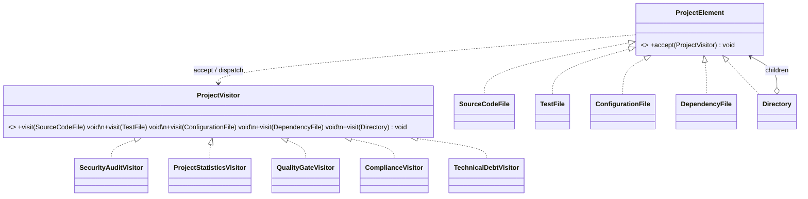
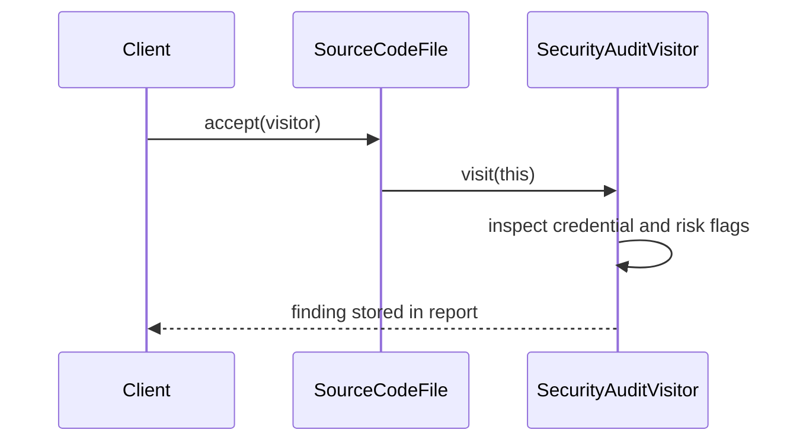

# Assignment 6 — Smart Code Inspection & Compliance Engine

**Pattern:** Visitor  
**Language:** Java 17  
**Build:** Maven  
**Tests:** JUnit 5

## 1. Project overview

This application analyzes a project tree without placing analysis operations inside the project elements. The element hierarchy represents the project structure; visitors contain independent operations that can be applied to the same structure.

The demo builds the requested `fintech-project/` tree:

```text
fintech-project/
├── src/
│   ├── PaymentService.java
│   └── UserService.java
├── tests/
│   └── PaymentServiceTest.java
├── config/
│   └── application.properties
└── pom.xml
```

The statistics visitor counts individual test cases from `TestFile.testsCount` (not merely the number of test files), and the Quality Gate uses the same test/source ratio. The demo data is intentionally mixed: the security audit finds no critical issues and the quality gate passes, while compliance reports that `UserService.java` has no mapped production test.

## 2. Architecture

### Elements

- `ProjectElement` — common element contract with `accept(ProjectVisitor)`.
- `SourceCodeFile` — path, LOC, cyclomatic-complexity estimate, credential and risk flags, production flag.
- `TestFile` — path, LOC, test counts and the production source path covered by the tests.
- `ConfigurationFile` — environment, security, exposed-credential and setting metadata.
- `DependencyFile` — dependency collection with version, vulnerability, prohibition and license metadata.
- `Directory` — composite element containing other `ProjectElement` objects, including nested directories.

### Visitors

- `SecurityAuditVisitor` — security findings, severity, score and report.
- `ProjectStatisticsVisitor` — file counts, LOC, individual test-case count, dependencies, average complexity and test/source ratio (individual tests / production source files).
- `QualityGateVisitor` — release decision based on complexity, tests and critical security issues.
- `ComplianceVisitor` — pinned versions, exposed credentials, prohibited dependencies and tests for production source files.
- `TechnicalDebtVisitor` — an additional visitor that estimates technical-debt points. It was added in its own Git commit and does not require changing element classes.

`Directory` is traversed recursively by each visitor. Leaf elements only dispatch to the matching overloaded `visit(...)` method. No `instanceof` or type-switch is used for element detection.

## 3. Double dispatch

The client calls `element.accept(visitor)`. The runtime element class chooses its own `accept` implementation, and `visitor.visit(this)` is then resolved to the overloaded method for that concrete element type. The operation therefore depends on both the concrete element and the concrete visitor: this is double dispatch.

## 4. Answers to the assignment questions

1. **What problem does Visitor solve?** It separates operations (auditing, statistics, quality and compliance) from the project data structure. New operations can be added without editing every element class.
2. **Where are Element and Visitor?** `ProjectElement` and its concrete implementations are in `model`; `ProjectVisitor` and concrete visitor implementations are in `visitor`.
3. **What is double dispatch?** `accept(visitor)` dispatches by the element's runtime type, then `visit(this)` dispatches to the matching overloaded visitor method.
4. **Why not put operations in Element classes?** That would mix data with many unrelated responsibilities and require edits to all element classes whenever a new operation is introduced.
5. **Is it easier to add a Visitor or an Element?** A Visitor is easier: add a new class implementing `ProjectVisitor`. A new element is more expensive because `ProjectElement`, `ProjectVisitor`, and every concrete visitor need a new `visit(NewElement)` method and implementation.
6. **When is Visitor a bad choice?** When element types change frequently, the hierarchy is small and stable only temporarily, or the operations need frequent access to internal state that would force many getters and weaken encapsulation.
7. **How is Visitor different from Strategy?** Strategy selects interchangeable algorithms behind a common interface, usually for one behavior. Visitor adds operations across a set of different element types and uses overloaded visits/double dispatch to select behavior for each type.
8. **Which SOLID principles are visible?** SRP: elements store project data while visitors perform analysis. OCP: new operations are added as new visitors. DIP: elements depend on the `ProjectVisitor` abstraction, not concrete audit classes. LSP: every concrete element can be used as a `ProjectElement`.

## 5. Visitor limitation: adding `DatabaseMigrationFile`

A new `DatabaseMigrationFile` requires:

1. a new class implementing `ProjectElement`;
2. a new overload `visit(DatabaseMigrationFile file)` in `ProjectVisitor`;
3. a corresponding implementation in **every** concrete visitor (security, statistics, quality, compliance and technical debt);
4. new tests and demo data for the new type.

This is the main trade-off: Visitor is convenient when operations are added often and the element hierarchy changes rarely. Adding an element changes the visitor interface and all visitor implementations.

## 6. Build and run

Requirements: JDK 17+ and Maven 3.8+.

```bash
mvn clean test
mvn -q exec:java -Dexec.mainClass=kz.edu.assignment6.demo.DemoApplication
```

The application can also be run from an IDE by starting `kz.edu.assignment6.demo.DemoApplication`. JUnit 5 tests are under `src/test/java`.

## 7. Tests

The JUnit suite contains 19 meaningful tests covering concrete dispatch, security findings, statistics, quality-gate PASS/FAIL, compliance violations, nested and empty directories, the additional visitor, invalid metrics and the demo project. Tests verify values and behavior, not only object creation.

## 8. UML

The source diagrams are in `docs/class-diagram.puml` and `docs/sequence-diagram.puml`. Mermaid versions are also included below for quick preview.

### Class diagram



### Sequence diagram



## 9. Git history

The repository contains multiple incremental commits. The `TechnicalDebtVisitor` was introduced as a separate final feature commit, without editing existing `ProjectElement` implementations.

## 10. Defense quick notes

- If `accept()` is removed, the client cannot dispatch a visitor operation through the element abstraction; the solution would need external type checks or another dispatch mechanism.
- If a new visitor is requested, create a new class implementing all five `visit` methods; existing elements remain unchanged.
- If a new element is requested, add it to the visitor interface and implement its visit method in every visitor.
- For deeply nested directories, recursion works because each visitor's `visit(Directory)` sends the same visitor to each child.
